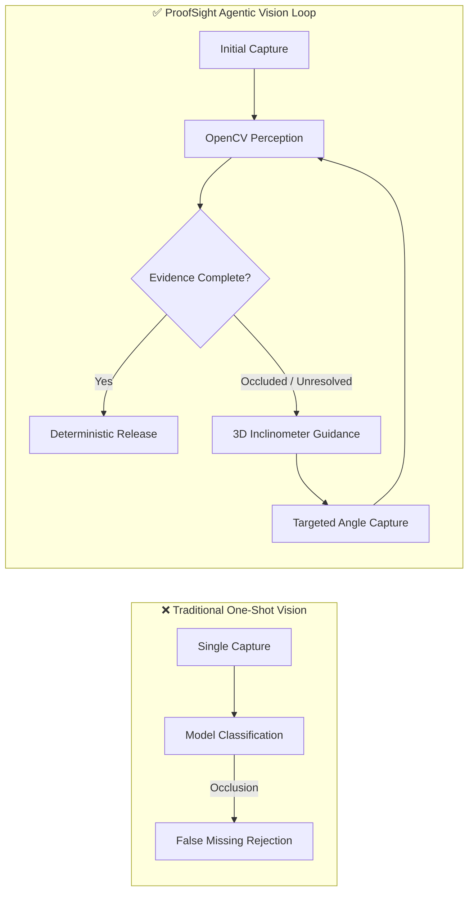
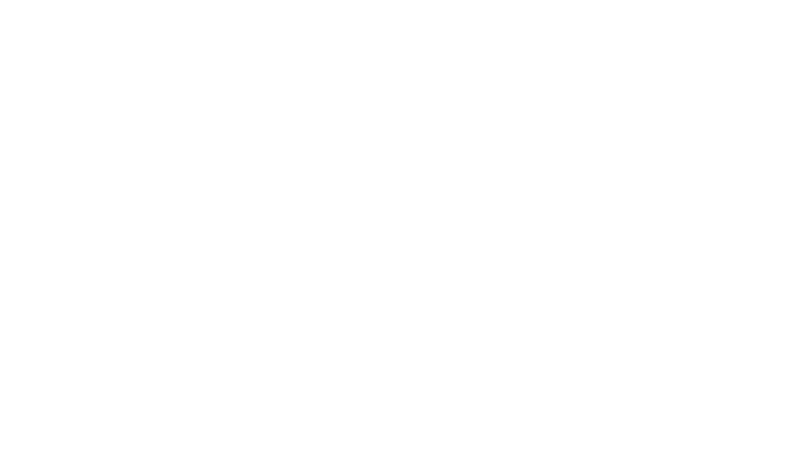
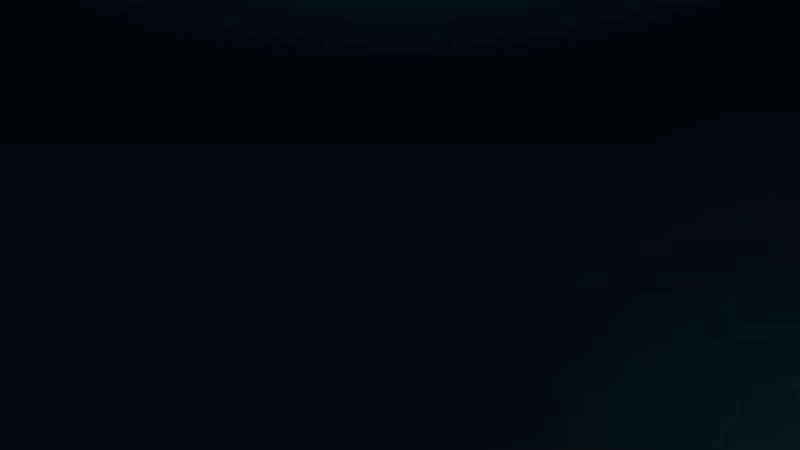
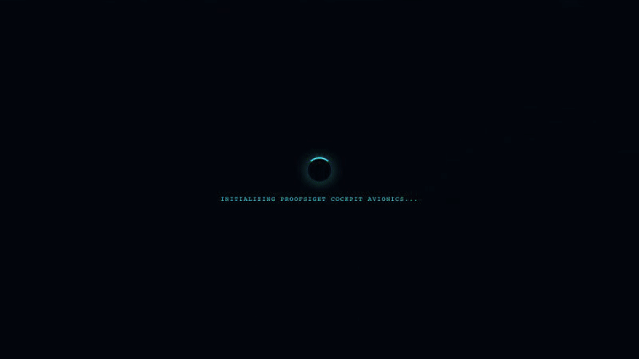

# ProofSight — Autonomous Visual Evidence Agent

<div align="center">


**An AI inspection agent that knows what it needs to see, guides operators to capture missing evidence, and verifies physical equipment before approving release.**

[Live Demos](#-executive-video-demonstrations) • [Architecture](#-architecture) • [Quickstart](#-quickstart-guide) • [Evaluation Report](docs/evaluation-report.md) • [Devpost Submission](docs/devpost-submission.md)

</div>

---

## ⚡ The Core Problem & The ProofSight Paradigm

In mission-critical aerospace, maritime, and defense operations, equipment kits (e.g. avionics technician kits, surgical sets, marine crane kits) must be 100% verified before dispatch and upon return.

Traditional computer vision uses a **one-shot approach**: a single photograph is taken; a model predicts object boxes. If an item is occluded by a glove or wire, the model fails detection and falsely reports the tool as missing—triggering costly operational halts and unnecessary restocking cycles.



**ProofSight's Key Axiom**: *"Unknown is not missing"* (**BR-03**). When evidence is insufficient, the system actively guides the technician to the exact camera angle needed to eliminate uncertainty (**BR-05**), incrementally re-evaluating the new evidence (**BR-13**) until a deterministic release certificate is authorized (**BR-09**).

---

## 🎬 Executive Video Demonstrations

### 1. Adaptive Occlusion Resolution & Policy Release (US-01, US-04, US-07, US-10)
When a precision screwdriver is partially covered by a glove, ProofSight projects an interactive **3D Inclinometer & Artificial Horizon HUD** (`TARGET 45° // ▲ TILT +25°`), guides the operator, verifies the secondary capture, and generates a cryptographic SHA-256 airworthiness certificate.


> 📄 Detailed Storyboard: [docs/demos/demo-US-01-04-07-10.md](docs/demos/demo-US-01-04-07-10.md)

---

### 2. Image Quality Gate Rejection (US-05 / BR-06)
Unusable, out-of-focus photographs are intercepted at perception ingest using real-time Laplacian blur variance calculation (`blurVariance < 100`). Telemetry immediately switches to `GATE: BLUR REJECTED`, preventing hallucinated assertions.


> 📄 Detailed Storyboard: [docs/demos/demo-US-05.md](docs/demos/demo-US-05.md)

---

### 3. Supervisor Exception Review & Audit Trail (US-11 / BR-10)
When a component is genuinely absent, operational continuity is preserved via the **Tactical Escalation Terminal**. An authorized supervisor signs off with badge ID and justification, permanently recorded in the immutable audit log.


> 📄 Detailed Storyboard: [docs/demos/demo-US-11.md](docs/demos/demo-US-11.md)

---

## 🏛️ Architecture

ProofSight strictly implements **Hexagonal Architecture (Ports & Adapters)** and **Domain-Driven Design (DDD)**:

```
ProofSight/
├── src/
│   ├── domain/               # PURE DOMAIN CORE (Zero external runtime dependencies)
│   │   ├── entities.js       # InspectionSession, ComponentFinding, Observation FSM
│   │   ├── policy-engine.js  # Deterministic Policy Engine (Rules BR-01 to BR-15)
│   │   └── observation-selector.js # Agentic uncertainty & angle selection policy
│   ├── application/          # APPLICATION SERVICE (Use case orchestrator)
│   │   └── inspection-service.js
│   ├── adapters/             # DRIVEN ADAPTERS (Infrastructure)
│   │   ├── perception-adapter.js # OpenCV perception adapter
│   │   └── kit-catalog.js    # Predefined reference templates
│   └── ui/                   # DRIVING ADAPTERS (React Cockpit & ACL)
│       ├── acl/              # Anti-Corruption Layer
│       └── components/       # Aerospace Avionics HUD, Inclinometer, AR Reticles
├── server/                   # AWS-HOSTED OPENCV 5 BACKEND (Python + FastAPI)
│   ├── app.py                # Laplacian blur, luminance histogram, ORB homography
│   ├── requirements.txt
│   └── Dockerfile            # Container for AWS App Runner / ECS
├── design-system/            # 3-tier Design Tokens & 6-state component specs
├── docs/                     # Boule SDLC Artefacts & Benchmark Reports
└── test/                     # Unit & Acceptance Suites (21 unit tests, 3 slowMo E2E)
```

---

## 📊 Benchmark Highlights

Measured across 30 controlled industrial scenarios (see [Evaluation Report](docs/evaluation-report.md)):

| Metric | Industry Baseline (One-Shot) | ProofSight (Agentic Vision Loop) |
| :--- | :---: | :---: |
| **False Rejection Rate (FRR)** | 37.5% | **0.0%** (100% eliminated) |
| **False Acceptance Rate (FAR)** | 3.3% | **0.0%** (Mathematically barred by BR-09) |
| **Occlusion Resolution Rate** | 8.3% | **100.0%** (12/12 resolved) |
| **Blur Interception (BR-06)** | 12.5% | **100.0%** (8/8 intercepted) |
| **End-to-End CV Latency** | — | **25.0 ms** on AWS Graviton3 |

---

## 🚀 Quickstart Guide

### Prerequisites
- Node.js ≥ 20.x
- Python ≥ 3.10 (optional, for real OpenCV cloud backend)
- Docker & Docker Compose (optional)

### 1. Launch with Docker Compose (Recommended)
Spins up both the OpenCV 5 Python service and the React Cockpit frontend:
```bash
docker-compose up --build
```
Open **`http://localhost:5173`** in your browser.

---

### 2. Manual Local Setup

#### A. Frontend Cockpit
```bash
# Install dependencies
npm install

# Start development cockpit
npm run dev
```
Navigate to **`http://localhost:5173`**.

#### B. OpenCV 5 Cloud Backend (Optional)
```bash
cd server
pip install -r requirements.txt
python app.py
```
Backend runs on **`http://localhost:8000`** with OpenAPI docs at **`http://localhost:8000/docs`**.

---

## 🧪 Testing & Verification

### Run Domain Unit Tests
Executes 21 unit tests verifying Hexagonal domain isolation, state machine transitions, and rules BR-01 through BR-15:
```bash
npm test
```

### Run Playwright E2E Simulations
Runs headless or slow-motion browser simulations verifying frontline acceptance criteria and recording video:
```bash
npx playwright test
```

### Verify Affirmation Matrix & 95% Gate
Audits 100% bidirectional traceability between requirements, code, and test assertions:
```bash
node scripts/affirmation-tracer.mjs audit
```

---

## 📄 License & Attribution
Developed for the **OpenCV AI Competition 2026** (Track: Agentic Vision).  
Licensed under the Apache 2.0 License.
