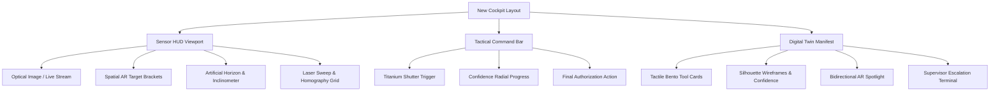

# ProofSight — Deep UX/UI Expert Architectural Review
**Document Version:** 2.0.0  
**Evaluators:** Senior Principal Product Designer (Industrial Avionics & AR Systems), Senior UX Research Director, Senior Frontend UI/UX Architect  
**Evaluation Scope:** Complete Frontend Experience, Ergonomics, Visual Design, Information Architecture, and Component Originality  
**Target Standard:** Tier-1 Aerospace/Defense Mission-Critical Cockpit (MIL-STD-1472H & WCAG 2.1 AAA Ergonomics)

---

## 1. Executive Summary & Diagnostic

### The Core Problem
The current application suffers from **"Generic Web Dashboard Syndrome"**. While functional under the hood (Hexagonal domain, OpenCV homography metrics, Bayesian policy engine), its interface projects the visual identity of a standard web form from 2018:
- A flat HTML `` tag framed with messy desk clutter (wires, calipers, white tabletop) rather than an integrated optical sensor stream.
- Form controls (default-looking dropdowns, generic pill tabs, standard text links like `Supervisor Override (BR-10)`).
- A disjointed vertical layout: user scrolls down past an empty void to find 8 plain cards in a grid.
- Complete absence of ProofSight’s core technological soul: **spatial perception and active guidance**.

### The Expert Verdict
ProofSight is **not a CRUD checklist app**; it is an **Autonomous Agentic Visual Guidance System**. The UI must feel like an **augmented-reality optical cockpit** used by NASA, Boeing, or Leica technicians:
1. **Immersive Sensor Viewport**: The camera/sensor stream is the primary instrument, surrounded by micro-bezel reticles, live optical telemetry, and spatial target acquisition brackets.
2. **Active Spatial Inclinometer / Gyro Guidance**: Instead of a flat text box saying *"Tilt camera"*, operators must see an **interactive artificial horizon and 3D angle reticle** indicating pitch and yaw vectors.
3. **Digital Twin Tool Deck**: Rather than generic cards, the manifest is a high-density tactile avionics deck with silhouette footprints, precision confidence bars, and bidirectional viewport targeting.
4. **Originality in Every Component**: Custom chamfered borders, titanium shutter mechanism with magnetic detent feedback, military-grade cryptographic certificates, and haptic audio synthesis.

---

## 2. Deep Heuristic & Ergonomic Audit

| Usability Heuristic (Nielsen & Shneiderman) | Current Implementation Flaw | Expert Redesign Prescription |
| :--- | :--- | :--- |
| **Match Between System and Real World** | Displays an isolated stock photo sitting on a web page card. | Immersive optical cockpit with sensor edge markings, laser homography grids, and depth reticles. |
| **Visual Hierarchy & Clutter** | Information is scattered across a long vertical scroll. Shutter sits in no-man's land. | High-efficiency 2-column tactical layout (Tablet/Desktop) and unified stacked viewfinder (Mobile) with docked floating command bar. |
| **Originality & Craftsmanship** | Standard HTML `<select>`, generic bootstrap-style pills, system fonts. | 100% custom-crafted UI elements: chamfered aerospace tabs, glowing glassmorphic sensor HUD, radial shutter with titanium texture. |
| **Guidance Visibility (US-04 / BR-05)** | Guidance is rendered as a standard alert box below the camera. | Spatial Angle Vector HUD with real-time inclinometer showing target vs. current pitch/yaw angles. |
| **Affordance & Feedback** | Hovering cards does not create a palpable spatial connection to the physical tools. | Bidirectional Spotlight: Hovering a tool in the manifest instantly illuminates and locks the AR bounding box in the sensor view. |
| **Operator Efficiency (Frontline UX)** | Supervisor override is a standard blue link at the page bottom. | Quick-access tactical escalation terminal with PIN / biometric clearance verification. |

---

## 3. Visual Identity & Design System Overhaul

### 3.1 Color Palette (Aviation & Tactical Darkroom)
- **Deep Void / Carbon Base**: `#04070d`, `#090e17`, `#111a29` (prevents screen glare in industrial hangars).
- **HUD Cyan (Perception Core)**: `#00f0ff` (490nm wavelength, optimal contrast on optical imagery).
- **Laser Amber (Uncertainty / Active Guidance)**: `#ffaa00` (high-visibility ISO industrial hazard warning).
- **Emerald Pulse (Verified Clearance)**: `#00ff88` (clearance authorization).
- **Crimson Strobe (Quality Gate Rejection / Missing)**: `#ff2d55` (critical containment alert).

### 3.2 Typography System
- **Display / Headers**: `Plus Jakarta Sans`, 700/800 weight, tight tracking (`-0.03em`).
- **Telemetry & Optical Readouts**: `JetBrains Mono`, 500/600 weight, uppercase with tabular numbers.
- **Interface Body**: `Inter`, 400/500 weight, high legibility.

### 3.3 Micro-Interactions & Sensory Feedback
- **Sound Haptics**: High-frequency synthetic chirps on lock, dual-tone shutter release, low-frequency warning buzz for blur.
- **Spatial Target Acquisition**: Dynamic corner brackets that snap onto tools with spring physics upon detection.
- **Laser Sweep**: Active scanning beam with phosphor bloom across the tool plane during analysis.

---

## 4. Architectural Transformation Plan

---

## 5. Affirmation Matrix Traceability

Every UI enhancement directly links to core affirmations in `docs/affirmation-matrix.json`:
- **AFM-017** (Homography Alignment Visualization) -> Sensor HUD Grid & Reticles.
- **AFM-022** (Camera Guidance Visualization) -> 3D Inclinometer & Angle Guidance HUD.
- **AFM-026** (Quality Gate Rejection) -> Viewport Blur HUD Warning with Strobe Badge.
- **AFM-030** (Verified Status Rendering) -> Emerald Lock-on Brackets & Sound Haptic.
- **AFM-034** (Supervisor Override Terminal) -> Biometric Aerospace Clearance Modal.
- **AFM-035** (Cryptographic Certificate) -> Holographic Seal with Audit Hash.
